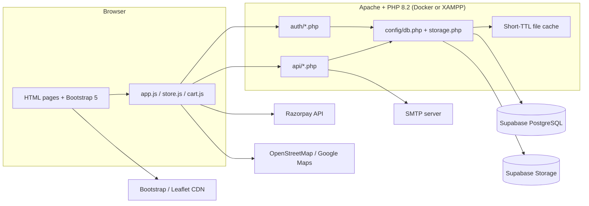
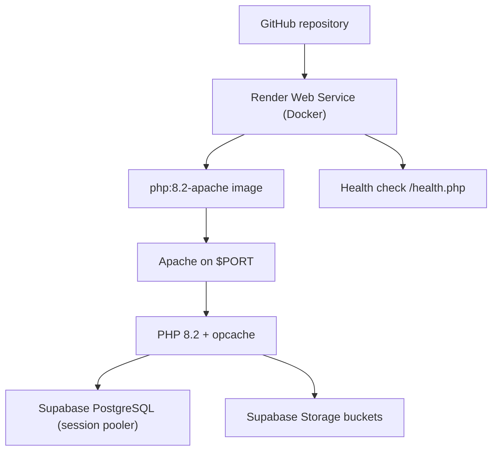
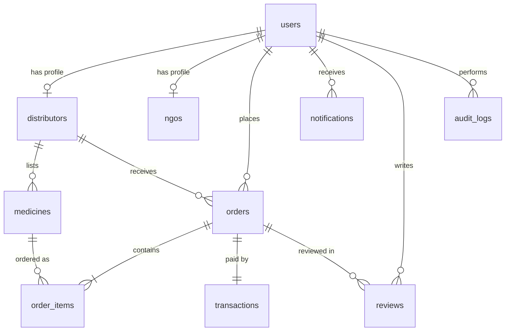
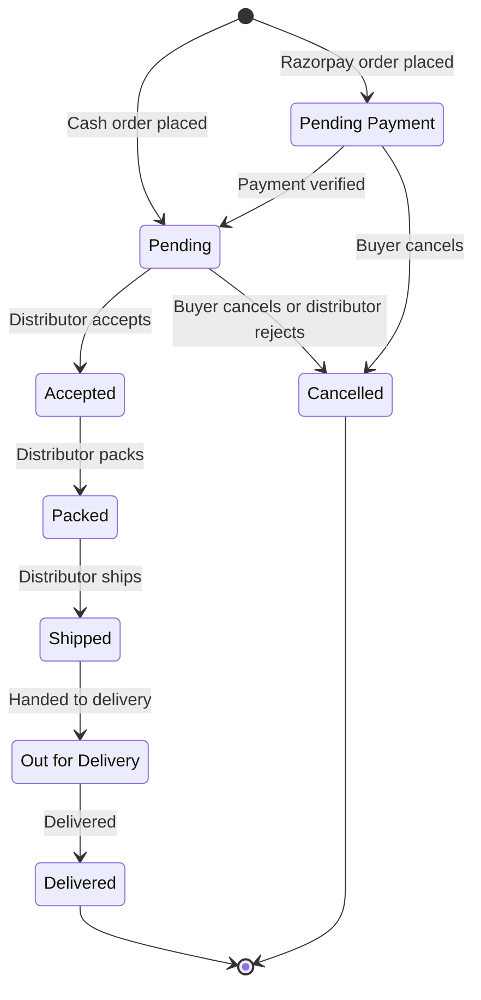

# MEDRED

## Medicine Donation and Distribution Platform

> *Don't waste medicines, redistribute hope.*

**Bachelor of Technology**

**Department of Computer Science and Engineering**

**[College Name]**

**Academic Year 2026–2027**

| Roll Number | Name |
|---|---|
| 24004-CS-098 | MANADI RUPA |
| 24004-CS-080 | DASI CHARAN KUMAR |
| 24004-CS-117 | VOLLALA SHANMUKHA SAI |
| 24004-CS-105 | BEJUGAM RAGHAVI |
| 24004-CS-101 | MEDIPELLI SHIVANI |
| 24004-CS-123 | DARAVATH BASANTHI |
| 24004-CS-068 | BUDDA CHAITANYA |
| 24004-CS-082 | NALABOLU SATWIK REDDY |
| 24004-CS-121 | BIJILI SAI CHARAN |

**Project Guide:** S. Ravinder
**Principal:** P. Srinivas

---

## Abstract

MEDRED is a web-based medicine donation and distribution platform that connects verified medicine distributors and pharmacies with non-governmental organizations, medical shops, old-age homes, orphanages and charitable hospitals. Distributors frequently hold surplus or near-expiry stock that cannot be sold through normal channels, while social organizations struggle to obtain even basic medicines. MEDRED turns this surplus into an organized, verified marketplace.

The application provides role-based access for administrators, distributors and organizations. Distributors publish stock with batch number, expiry date, price and quantity. Organizations search the store, build a cart, provide delivery details and pay through Razorpay or select cash on delivery. Every order follows a controlled lifecycle with server-enforced transitions, transactional stock handling, cancellation and rejection support, in-app notifications, reviews, reports with CSV export and a complete audit trail. Expired and out-of-stock medicines are removed automatically, and account verification is performed by an administrator after reviewing the submitted license or registration document.

The system is implemented with PHP 8.2 on Apache, PostgreSQL hosted on Supabase, Supabase Storage for documents, Bootstrap 5 and vanilla JavaScript, and is packaged as a Docker image for deployment on Render. It includes a thirty-day persistent sign-in, SMTP-based password-reset OTP, delivery navigation through Google Maps, and multiple caching and database optimizations. Functional testing was carried out at the API, browser and live-deployment levels, and all recorded test cases passed.

**Keywords:** medicine donation, medicine redistribution, e-commerce, order management, Razorpay, Supabase, PHP, PostgreSQL.

---

## Table of Contents

| # | Topic | Page |
|---|---|---|
| 1 | Introduction | 7 |
| 2 | Problem Statement & Motivation | 8 |
| 3 | Project Scope & Objectives | 9 |
| 4 | System Architecture | 10 |
| 5 | Technical Stack | 12 |
| 6 | Database Design | 13 |
| 7 | Implementation | 15 |
| 8 | Order Lifecycle & Payments | 18 |
| 9 | Security | 19 |
| 10 | Performance Optimization | 20 |
| 11 | Testing & Results | 21 |
| 12 | Limitations & Future Work | 23 |
| 13 | Conclusion & References | 24 |
| — | Appendix — Setup & API Reference | — |

---

## 1. Introduction

### 1.1 Background

Medicines are essential, time-sensitive products. Distributors and pharmacies routinely carry surplus stock, and a portion of it approaches expiry before it can be sold through normal commercial channels. At the same time, NGOs, old-age homes, orphanages, charitable hospitals and small medical shops often lack the funds and supply network to obtain even basic medicines. The result is a persistent mismatch: usable medicine is discarded while genuine demand remains unmet.

Most redistribution today happens through phone calls, messaging applications and personal contacts. These channels provide no verified participants, no live stock information, no price transparency, no order tracking, no payment records and no audit trail.

MEDRED was built to replace that informal process with a structured digital platform. It is a donation-oriented redistribution marketplace in which near-expiry, still-usable medicine is offered at reduced prices and delivered to verified social organizations.

### 1.2 What the Platform Does

MEDRED supports the full operational cycle:

1. An organization or distributor registers and uploads a license or registration document.
2. An administrator reviews the document and approves or rejects the account.
3. A verified distributor publishes medicines with batch number, expiry date, price, MRP and stock.
4. A verified organization searches the catalogue, filters by category or shelf life, and adds items to a cart.
5. The organization enters a delivery address and a ten-digit mobile number, optionally shares browser location, and chooses a payment method.
6. The order is split by distributor, stock is reserved, and a transaction record is created.
7. The distributor accepts, packs, ships, marks the parcel out for delivery and finally delivers it.
8. Notifications, reviews, reports, audit logs and printable invoices record the entire process.

### 1.3 Roles

| Role | Description | Main Capabilities |
|---|---|---|
| **Admin** | Platform operator | Verify or reject accounts, view all medicines, orders, reports, distributors, audit logs and the delivery map |
| **Distributor** | Licensed medicine supplier | Manage own inventory, accept or reject orders, pack, ship, deliver, confirm manual payments, view own orders and reports |
| **Organization (`org`)** | NGO, medical shop, old-age home, orphanage or charitable hospital | Browse the store, place and cancel orders, pay online, review delivered orders, manage profile and delivery location |

The role is stored on the `users` table and enforced on every API request. The user interface hides pages that are not available to a role, but the server remains the authority.

### 1.4 Report Organization

This report describes the problem and motivation (Section 2), scope and objectives (Section 3), system architecture (Section 4), technical stack (Section 5), database design (Section 6), implementation details (Section 7), the order lifecycle and payment flow (Section 8), security controls (Section 9), performance optimization (Section 10), testing and results (Section 11), limitations and future work (Section 12), and the conclusion and references (Section 13). The appendix contains setup instructions, environment variables, seed accounts and an API reference.

---

## 2. Problem Statement & Motivation

### 2.1 The Wastage–Access Gap

A large quantity of usable medicine is wasted every year because distributors and pharmacies hold surplus or near-expiry stock that is difficult to sell. Near-expiry products lose commercial value long before they become unsafe, so they are often written off, returned to manufacturers or destroyed. In parallel, social organizations that serve vulnerable people operate on tight budgets and cannot afford market prices for routine medicines.

### 2.2 Problems with the Informal Process

The current redistribution process is largely manual and informal:

- **No common marketplace.** Buyers and sellers depend on personal contacts and messaging groups.
- **No verification.** An organization cannot easily confirm that a supplier is licensed, and a distributor cannot confirm that a buyer is a legitimate social organization.
- **No live inventory.** Stock, batch numbers and expiry dates are communicated verbally and become stale quickly.
- **No price transparency.** Prices vary unpredictably and there is no record of what was agreed.
- **No order tracking.** There is no controlled sequence from acceptance to delivery.
- **No payment record.** Cash and bank transfers are not linked to specific orders.
- **No accountability.** There is no audit trail for verification, stock changes, cancellations or payments.
- **No expiry control.** Near-expiry stock may be shipped without adequate visibility, and expired stock may remain listed.
- **No delivery visibility.** Distributors may not know the exact delivery address or location.

### 2.3 Motivation

The motivation for MEDRED is threefold:

1. **Reduce wastage.** Give distributors a simple channel to move near-expiry stock before it becomes unusable.
2. **Improve access.** Give verified social organizations an affordable, reliable source of medicines with transparent expiry information.
3. **Establish trust.** Enforce verification, controlled order states, server-verified payments and audit logging so that both sides can rely on the platform.

The project also demonstrates how a small, focused application built with a low-cost stack can address a real operational problem without requiring a large enterprise system.

---

## 3. Project Scope & Objectives

### 3.1 Scope

**In scope:**

- Registration and admin verification for distributors and organizations.
- License or registration document upload with private storage.
- Distributor inventory management, including image upload, camera capture, expiry validation and soft deletion.
- Public storefront with search, category filters, shelf-life filters and sorting.
- Cart persisted in the browser, checkout with delivery address, delivery phone and geolocation.
- Order creation with per-distributor splitting and a minimum order value.
- Full order lifecycle from payment to delivery, including cancellation and rejection.
- Razorpay online payments with server-side signature verification.
- Cash on delivery and manual payment confirmation.
- In-app notifications, unread badge and optional email/SMS notification stubs.
- Reviews for delivered orders.
- Admin reports, CSV export and audit logs.
- Delivery map and address-first navigation.
- Persistent sign-in and password reset through email OTP.
- Docker packaging, health check and deployment on Render.

**Out of scope:**

- Native Android or iOS applications.
- Courier or delivery-partner API integration.
- Automated OCR-based verification of license documents.
- Live SMS gateway integration.
- Multi-language support.
- Automated tax, e-invoice or regulatory filing.
- Live Razorpay production onboarding and compliance.
- Multi-tenant operation for multiple independent platforms.

### 3.2 Objectives

1. Provide a single, verified marketplace for surplus and near-expiry medicines.
2. Enforce role-based access so that each participant can perform only permitted actions.
3. Maintain accurate stock levels with transactional reservation, restoration and automatic delisting.
4. Prevent expired or out-of-stock medicines from appearing in the store.
5. Provide a clear order lifecycle with server-side validation of every transition.
6. Support both online payment (Razorpay) and cash on delivery.
7. Keep buyers and distributors informed through notifications.
8. Record every significant action in an audit log.
9. Offer role-specific dashboards, reports and delivery navigation.
10. Keep the system deployable at low cost using managed PostgreSQL and object storage.
11. Protect credentials, documents and payment secrets.
12. Keep frequent read paths responsive despite a remotely hosted database.

### 3.3 Functional Requirements

| Area | Requirement |
|---|---|
| Accounts | Register as distributor or organization; require a valid email, ten-digit phone, city and license/registration number |
| Verification | Admin approves or rejects pending accounts; rejection removes the registration completely |
| Authentication | Login only for verified accounts; persistent session; logout; password reset with OTP |
| Inventory | Add, update and soft-delete medicines; validate future expiry; upload a photo; notify on low stock and expiry |
| Store | Public catalogue with search, category, shelf life, distributor filter and sorting |
| Cart | Browser-persisted cart with quantity control and stale-item cleanup |
| Checkout | Delivery address, ten-digit phone, optional geolocation, minimum order value |
| Orders | Split by distributor; controlled statuses; buyer cancellation; distributor rejection with stock restoration |
| Payments | Razorpay order creation and HMAC verification; manual cash/bank confirmation |
| Reviews | One review per delivered order; rating 1–5 and optional comment |
| Notifications | In-app list, unread count, mark-all-read; optional email and SMS log |
| Reports | Platform statistics, category stock, expiry risk and CSV export |
| Audit | Last fifty actions with user and timestamp |
| Maps | Verified locations on a Leaflet map; address-first navigation to a delivery destination |

### 3.4 Non-Functional Requirements

| Requirement | Approach |
|---|---|
| Security | Hashed passwords, signed cookies, prepared statements, RBAC, server-side payment verification, upload validation |
| Performance | Short-TTL server cache, client cache, indexed queries, single-round-trip notification writes |
| Reliability | Transactions for stock and order writes; rollback on failure; cache invalidation on write |
| Usability | Responsive Bootstrap interface, toasts, modals, role-aware navigation |
| Portability | Environment-first configuration with Docker and a local XAMPP fallback |
| Maintainability | Plain PHP with shared helpers, no framework dependency, documented changelog |
| Scalability | Stateless PHP layer; managed PostgreSQL and object storage |

---

## 4. System Architecture

### 4.1 High-Level Architecture

MEDRED follows a three-tier architecture: a static browser client, a PHP API layer and a managed data layer. There is no server-side rendering framework and no build step for frontend assets.



### 4.2 Layer Responsibilities

| Layer | Responsibility | Key Files |
|---|---|---|
| Presentation | Static pages, styling, client-side rendering, modals, toast messages | `index.html`, `store.html`, `dashboard.html`, `cart.html`, `profile.html`, `map.html`, `delivery-map.html`, `css/style.css` |
| Client logic | Fetch API data, cart management, navigation, Razorpay Checkout, geolocation, Leaflet maps | `js/app.js`, `js/store.js`, `js/cart.js` |
| Application/API | Authentication, validation, role checks, business rules, JSON responses | `auth/*.php`, `api/*.php` |
| Shared services | Database connection, sessions, JSON helpers, cache, audit, notifications, SMTP, storage | `config/db.php`, `config/storage.php` |
| Persistence | Relational data and private/public files | Supabase PostgreSQL, Supabase Storage, local `uploads/` fallback |
| External services | Payments, email, maps, CDN | Razorpay, SMTP, OpenStreetMap, Google Maps, jsDelivr |

### 4.3 Request Flow

1. The browser loads a static HTML page and its JavaScript.
2. The client calls an `auth/` or `api/` endpoint with either JSON or `FormData`.
3. The endpoint includes `config/db.php`, which loads environment variables or `config/secrets.php`, initializes helpers and opens a PDO connection only when `db()` is first used.
4. `current_user()` starts the session, checks the session user and falls back to the signed remember cookie. The session file lock is released immediately after reading.
5. Role guards (`require_role()`) and ownership checks protect mutations.
6. Read endpoints consult the short-TTL file cache before querying PostgreSQL.
7. Mutations run in transactions where multiple rows are affected, then clear the server cache.
8. Responses use the `{ "ok": true|false, ... }` convention with appropriate HTTP status codes.
9. The client updates the DOM, toasts and local caches, and invalidates cached GET URLs after writes.

### 4.4 Caching Architecture

Two independent cache layers reduce latency:

- **Server cache.** JSON files written under the system temporary directory in `medshare_cache/<namespace>/<hash>.json`. Short TTLs range from 10 to 60 seconds. Every POST call clears all cached GET responses.
- **Client cache.** `js/app.js` keeps an in-memory `Map` with a default 30-second TTL; `js/cart.js` uses `sessionStorage` with a 60-second TTL for storefront pages.

Cache keys include the user identifier for user-scoped data, so cached responses are not shared between accounts.

### 4.5 Deployment Architecture



The same codebase runs locally under XAMPP. Configuration is read from environment variables first, then from the gitignored `config/secrets.php`. When the Supabase service role key is absent, uploads fall back to local folders so development works without cloud credentials.

### 4.6 Project Structure

| Path | Contents |
|---|---|
| `auth/` | Login, registration, logout, session and password reset |
| `api/` | Medicines, orders, payments, notifications, reviews, reports, distributors, verification, audit, profile and locations |
| `config/` | Database/bootstrap helpers, storage integration, secrets template |
| `css/`, `js/` | Styling and client logic |
| `docker/` | Apache security configuration, PHP configuration, entrypoint |
| `scripts/` | One-time upload migration to Supabase Storage |
| `uploads/` | Local fallback for medicine images and license documents |
| `logs/` | SMS stub log |
| `database.sql` | PostgreSQL schema and seed data |
| `Dockerfile`, `health.php` | Deployment and health check |

---

## 5. Technical Stack

### 5.1 Stack Summary

| Layer | Technology | Version | Purpose |
|---|---|---|---|
| Markup | HTML5 | — | Static page structure |
| Styling | CSS3 + Bootstrap | 5.3.3 | Responsive layout, cards, modals, toasts |
| Icons | Bootstrap Icons | 1.11.3 | Interface icons |
| Client scripting | Vanilla JavaScript (ES6) | — | Rendering, fetch calls, cart, checkout, maps |
| Map rendering | Leaflet | 1.9.4 | Verified-location map with OpenStreetMap tiles |
| Payments | Razorpay Checkout | Hosted script | UPI, card and netbanking payments |
| Server language | PHP | 8.2 | API endpoints and business logic |
| Web server | Apache | 2.4 | Static files, PHP execution, rewrite rules |
| Database | PostgreSQL | Managed by Supabase | Relational data store |
| Database driver | PDO `pdo_pgsql` | Bundled | Prepared statements and transactions |
| Object storage | Supabase Storage | REST API | Medicine images and private documents |
| Email | cURL SMTP client | — | Password-reset OTP and optional notification email |
| Container | Docker | `php:8.2-apache` base | Reproducible deployment |
| Hosting | Render | Docker runtime | Public deployment with health check |
| Version control | Git / GitHub | — | Source management |

### 5.2 Rationale

- **Plain PHP, no framework.** The application has a small number of endpoints and does not require a framework's routing, ORM or templating. Avoiding Composer dependencies keeps the Docker image simple and removes a supply-chain surface.
- **PostgreSQL on Supabase.** A hosted relational database provides durable storage, TLS and a connection pooler without operating a database server.
- **Supabase Storage.** Medicine images are public; license documents are private and delivered through short-lived signed URLs. This avoids storing sensitive documents in a web-accessible directory in production.
- **Vanilla JavaScript.** The interface is page-oriented rather than a single-page application. Small shared modules are sufficient and avoid a Node build pipeline.
- **Bootstrap.** Provides a consistent, responsive UI, modals and toasts with minimal custom CSS.
- **Docker on Render.** A single container reproduces the Apache/PHP environment and supports a zero-configuration health check.

### 5.3 PHP Extensions and Server Configuration

Required extensions: `pdo`, `pdo_pgsql`, `pgsql`, `curl`, `mbstring`, `fileinfo`, `openssl`, `opcache`. The Dockerfile fails the build if any required extension is missing.

The production PHP configuration disables error display, logs to standard error, limits uploads to 4 MB (`post_max_size` 8 MB), sets strict session mode, and enables opcache with timestamp validation disabled.

### 5.4 External Integrations

| Integration | Used For | Failure Behaviour |
|---|---|---|
| Razorpay REST API | Create payment orders and verify signatures | Returns a gateway error; the order remains `Pending Payment` |
| SMTP | Password-reset OTP and optional notifications | Production returns a configuration error; development falls back to a temp log |
| OpenStreetMap tiles | Leaflet map | Map falls back to a default centre |
| Google Maps | Delivery navigation and embedded map | Navigation link remains available without JavaScript embedding |
| jsDelivr CDN | Bootstrap, icons, Leaflet, Razorpay Checkout | Interface may degrade if the CDN is unavailable |

---

## 6. Database Design

### 6.1 Entity-Relationship Overview



### 6.2 Tables

#### `users`

Stores all accounts regardless of role.

| Column | Type | Notes |
|---|---|---|
| `id` | `INT` identity | Primary key |
| `name` | `VARCHAR(120)` | Required |
| `email` | `VARCHAR(150)` | Required, unique |
| `password` | `VARCHAR(255)` | `password_hash()` output |
| `phone` | `VARCHAR(20)` | Ten-digit mobile number |
| `address` | `VARCHAR(255)` | Optional profile address |
| `city` | `VARCHAR(80)` | Required at registration |
| `latitude`, `longitude` | `DECIMAL` | Optional map position |
| `role` | `VARCHAR(20)` | Checked: `admin`, `distributor`, `org` |
| `org_type` | `VARCHAR(30)` | Checked: `NGO`, `Medical Shop`, `Old-Age Home`, `Orphanage`, `Charitable Hospital` |
| `verified` | `SMALLINT` | `0` pending, `1` approved |
| `created_at` | `TIMESTAMP` | Default current time |

#### `distributors`

One-to-one profile for distributor accounts.

| Column | Type | Notes |
|---|---|---|
| `id` | `INT` identity | Primary key |
| `user_id` | `INT` | Unique foreign key to `users(id)` |
| `license_no` | `VARCHAR(60)` | Drug license number |
| `license_image` | `VARCHAR(255)` | Stored relative path |
| `verified` | `SMALLINT` | Mirrors account verification |

#### `ngos`

One-to-one profile for organization accounts.

| Column | Type | Notes |
|---|---|---|
| `id` | `INT` identity | Primary key |
| `user_id` | `INT` | Unique foreign key to `users(id)` |
| `org_type` | `VARCHAR(30)` | Organization category |
| `registration_no` | `VARCHAR(60)` | NGO/trust registration number |
| `license_image` | `VARCHAR(255)` | Stored relative path |
| `verified` | `SMALLINT` | Mirrors account verification |

#### `medicines`

Inventory listed by distributors.

| Column | Type | Notes |
|---|---|---|
| `id` | `INT` identity | Primary key |
| `distributor_id` | `INT` | Foreign key to `distributors(id)` |
| `name` | `VARCHAR(120)` | Required |
| `category` | `VARCHAR(60)` | Required |
| `price` | `DECIMAL(10,2)` | Selling price |
| `mrp` | `DECIMAL(10,2)` | Optional; shown as discount when above price |
| `stock` | `INT` | Available units |
| `batch_no` | `VARCHAR(40)` | Optional |
| `image` | `VARCHAR(255)` | Public image path or URL |
| `expiry` | `DATE` | Must be a future date |
| `low_stock_notified` | `SMALLINT` | Prevents duplicate low-stock alerts |
| `deleted` | `SMALLINT` | Soft-delete flag |
| `created_at` | `TIMESTAMP` | Default current time |

Indexes: `medicines_expiry_idx (expiry)` and `medicines_category_idx (category)`.

#### `orders`

One order per distributor per checkout.

| Column | Type | Notes |
|---|---|---|
| `id` | `INT` identity | Primary key |
| `org_user_id` | `INT` | Buyer foreign key to `users(id)` |
| `distributor_id` | `INT` | Seller foreign key to `distributors(id)` |
| `delivery_address` | `TEXT` | Required |
| `delivery_phone` | `VARCHAR(15)` | Ten-digit number |
| `latitude`, `longitude` | `DECIMAL` | Optional delivery position |
| `total` | `DECIMAL(10,2)` | Computed server-side |
| `status` | `VARCHAR(20)` | Constrained lifecycle status |
| `tracking_number` | `VARCHAR(100)` | Set at delivery |
| `delivered_at` | `TIMESTAMP` | Set at delivery |
| `created_at` | `TIMESTAMP` | Default current time |

#### `order_items`

Line items for each order.

| Column | Type | Notes |
|---|---|---|
| `id` | `INT` identity | Primary key |
| `order_id` | `INT` | Foreign key with `ON DELETE CASCADE` |
| `medicine_id` | `INT` | Foreign key to `medicines(id)` |
| `qty` | `INT` | Ordered quantity |
| `price` | `DECIMAL(10,2)` | Unit price at order time |

#### `transactions`

One payment record per order.

| Column | Type | Notes |
|---|---|---|
| `id` | `INT` identity | Primary key |
| `order_id` | `INT` | Unique foreign key to `orders(id)` |
| `amount` | `DECIMAL(10,2)` | Order total |
| `method` | `VARCHAR(20)` | `Cash`, `Bank Transfer`, `UPI`, `Card`, `Razorpay` |
| `status` | `VARCHAR(20)` | `Pending`, `Completed`, `Failed`, `Cancelled` |
| `reference` | `VARCHAR(60)` | Razorpay order/payment id or external reference |
| `txn_date` | `TIMESTAMP` | Default current time |

#### `notifications`

In-app messages for a user.

| Column | Type | Notes |
|---|---|---|
| `id` | `INT` identity | Primary key |
| `user_id` | `INT` | Foreign key to `users(id)` |
| `type` | `VARCHAR(20)` | `expiry`, `order`, `verify`, `system`, `low_stock` |
| `text` | `VARCHAR(255)` | Message |
| `is_read` | `SMALLINT` | `0` unread, `1` read |
| `created_at` | `TIMESTAMP` | Default current time |

#### `reviews`

Reviews submitted by organizations for delivered orders.

| Column | Type | Notes |
|---|---|---|
| `id` | `INT` identity | Primary key |
| `order_id` | `INT` | Foreign key to `orders(id)` |
| `user_id` | `INT` | Reviewer foreign key to `users(id)` |
| `rating` | `SMALLINT` | 1–5 |
| `comment` | `VARCHAR(500)` | Optional |
| `created_at` | `TIMESTAMP` | Default current time |

#### `audit_logs`

Accountability trail.

| Column | Type | Notes |
|---|---|---|
| `id` | `INT` identity | Primary key |
| `user_id` | `INT` | Foreign key to `users(id)` |
| `action` | `VARCHAR(255)` | Human-readable action |
| `created_at` | `TIMESTAMP` | Default current time |

### 6.3 Design Decisions

- **Single `users` table with role.** Authentication and shared profile fields are centralized; role-specific data lives in `distributors` and `ngos`.
- **Soft deletion for medicines.** The `deleted` flag removes items from the store while preserving order history and avoiding broken foreign keys.
- **Stock reserved at order placement.** This prevents overselling. Rejection and cancellation restore stock inside the same transaction.
- **Orders split per distributor.** A single cart may contain items from multiple distributors; each resulting order has one seller and its own payment record.
- **One-to-one transaction per order.** Simplifies payment state and reconciliation.
- **Delivery coordinates stored on the order.** A profile move later does not change the historical delivery destination.
- **Status constraints in the database.** `CHECK` constraints prevent invalid order, transaction, role and organization types even if application logic is bypassed.
- **Seed data for demonstration.** Seven accounts, eight medicines, three orders and related records are inserted by `database.sql`. All seeded passwords are bcrypt hashes of `admin123`.

### 6.4 Seed Accounts

| Email | Role | Organization Type | Verified |
|---|---|---|---|
| `admin@medshare.com` | Admin | — | Yes |
| `medplus@medshare.com` | Distributor | — | Yes |
| `pharmalink@medshare.com` | Distributor | — | Yes |
| `carefirst@medshare.com` | Distributor | — | No |
| `hope@medshare.com` | Organization | Orphanage | Yes |
| `citycare@medshare.com` | Organization | Charitable Hospital | Yes |
| `eldercare@medshare.com` | Organization | Old-Age Home | No |

---

## 7. Implementation

### 7.1 Project Bootstrap and Helpers

All endpoints share `config/db.php`, which provides:

- environment-first configuration with a `config/secrets.php` fallback;
- `db_dsn_from_url()` for `postgresql://` connection strings;
- `DB_DSN`, `DB_USER`, `DB_PASS` and service constants;
- `ms_session_start()`, signed remember-cookie functions and `current_user()`;
- `db()` with a static PDO instance and no persistent connections;
- `respond()` and `body()` for JSON exchange;
- `cache_get()`, `cache_put()` and `cache_clear()`;
- `audit_log()`, `smtp_send()` and `notify()`;
- `require_role()`.

The lazy PDO connection means public GETs that hit the cache do not open a database connection at all.

### 7.2 Registration and Admin Verification

`auth/register.php` accepts multipart form data. It validates the name, email, password length, ten-digit phone, city and credential number, rejects duplicate email addresses and requires a license/registration image. The image is validated by extension, size (2 MB) and real MIME type, then stored through the storage abstraction.

A database transaction creates:

1. the `users` row with `verified = 0`;
2. the matching `distributors` or `ngos` row with the credential and document path;
3. an audit log entry.

If the transaction fails, the uploaded file is removed.

`api/verify.php` is admin-only. It lists pending accounts with short-lived signed document URLs (in Supabase mode) or local paths (in development). Approval sets `users.verified` and the profile `verified` flags to `1` and sends a notification. Rejection deletes the user, profile, notifications and audit rows, removes the document and allows the email to register again.

### 7.3 Authentication, Sessions and Remembered Login

`auth/login.php` validates credentials with `password_verify()`, blocks unverified accounts, regenerates the session ID, stores a compact user object in `$_SESSION` and audits the login. `auth/logout.php` clears the session, deletes the remember cookie and destroys the session.

Sessions use a thirty-day lifetime. In addition, `remember_login()` issues an HMAC-signed cookie:

```
base64(user_id | expiry | HMAC-SHA256(user_id | expiry | password_hash, RESET_SECRET))
```

`remember_user()` verifies the signature, checks expiry and the current password hash, and reloads the user from the database. A password change invalidates all remember cookies automatically. On Render, where session files are ephemeral, the cookie restores a login after a restart or redeploy.

`current_user()` releases the PHP session file lock with `session_write_close()` immediately after reading, which allows parallel requests from the same browser to proceed.

### 7.4 Medicine Inventory

`api/medicines.php` handles distributor inventory:

- **Add/update.** Accepts multipart fields and validates required values, positive price, non-negative stock, a valid future expiry and an optional image. Updating replaces the old image through `storage_delete_upload()`.
- **Delete.** Sets `deleted = 1` and `stock = 0` without removing the row, preserving order history.
- **Automatic delisting.** A list request sweeps expired items and zero-stock items, marks them deleted and notifies the distributor once. A separate sweep sends a low-stock alert when stock is between 1 and 249 units, controlled by `low_stock_notified`.
- **Store list.** The public GET returns active, non-expired medicines with a computed `shelf_months` value and a public image URL. Distributor accounts are scoped to their own inventory; other roles see all active stock. Search, category and shelf-life filters are applied server-side after fetching the filtered result set, and the response is cached briefly.
- **Single item.** `?id=N` returns one medicine with distributor contact details and an average rating.

The frontend also supports camera capture: `navigator.mediaDevices.getUserMedia` streams to a video element and a canvas encodes a JPEG that is submitted as a `File`.

### 7.5 Storefront, Cart and Checkout

The public storefront (`store.html`, `index.html`, `medicine.html`, `distributor.html`) is rendered by `js/store.js`:

- Featured medicines on the home page are the four nearest-expiry items.
- The store supports name search, category chips, sorting by expiry or price, and a distributor filter.
- Medicine cards show category, shelf-life pill, batch, stock, price, MRP discount and an add button.
- The medicine detail page shows distributor contact details and reviews.
- The distributor profile page lists the distributor's medicines and aggregate rating.

The cart is stored in `localStorage` under `medshare_cart`. `cart.html` re-fetches each medicine by id (because the list endpoint is distributor-scoped for distributor logins), removes stale entries, allows quantity changes and displays a per-distributor minimum-order warning. Checkout collects the delivery address, ten-digit phone and optional geolocation, and remembers the address and phone in first-party cookies.

### 7.6 Order Creation

`api/orders.php` creates orders only for the `org` role. Inputs are validated and then processed inside a transaction:

1. Each medicine is loaded with `FOR UPDATE` to lock its row.
2. Unknown, expired or insufficient-stock items abort the transaction.
3. Stock is decremented; if it reaches zero, the medicine is soft-deleted and its distributor is notified.
4. Items are grouped by distributor.
5. Each group must meet the ₹500 minimum.
6. An order, its line items and a transaction are inserted for each distributor.
7. Notifications are sent to the buyer and the distributor, and an audit entry is written.
8. The response returns the created order ids.

Razorpay orders start as `Pending Payment`; cash orders start as `Pending`. If no delivery address is supplied (dashboard quick order), the buyer's saved profile address is used. A ten-digit phone number is mandatory.

### 7.7 Notifications

`notify()` inserts a notification and fetches the recipient in one PostgreSQL CTE round trip. When email notification is enabled, it uses the built-in cURL SMTP sender or `mail()`. When a phone number exists, it appends an SMS record to `logs/sms.log`; this is a placeholder for a live gateway.

`api/notifications.php` returns the latest fifty notifications and supports a mark-all-read action. The dashboard badge and the storefront navigation badge poll the unread count at intervals.

### 7.8 Reviews

`api/reviews.php` allows an organization to review only its own delivered order, only once. The ratings are aggregated per distributor for public display. A separate `mine=1` view returns the organization's pending reviewable orders, submitted reviews and summary statistics.

### 7.9 Reports and Audit

`api/reports.php` returns platform statistics, stock by category and medicines expiring within three months. The statistics exclude soft-deleted medicines; revenue sums completed transactions. `?format=csv` streams a CSV file. `api/audit.php` returns the last fifty audit entries to administrators.

### 7.10 Delivery Maps and Navigation

`api/locations.php` returns verified users with saved coordinates. The admin dashboard renders them in a Leaflet map with OpenStreetMap tiles. On the orders table, the distributor can open `delivery-map.html`, which passes the delivery address, phone and coordinates through `localStorage` and embeds a Google Maps view. Navigation prefers the typed address and falls back to coordinates.

### 7.11 Storage and Uploads

`config/storage.php` defines five buckets:

| Bucket | Visibility | Purpose |
|---|---|---|
| `medicine-images` | Public | Medicine photos |
| `distributor-documents` | Private | Distributor license documents |
| `ngo-documents` | Private | Organization registration documents |
| `invoices` | Private | Reserved |
| `qr-codes` | Private | Reserved |

When `SUPABASE_URL` and `SUPABASE_SERVICE_ROLE_KEY` are set, files are uploaded through the Storage REST API with upsert enabled; buckets are created on demand and retried once if missing. Public URLs are returned for medicine images, and one-hour signed URLs are generated for private documents. When storage is not configured, files are written to `uploads/medicines/` or `uploads/licenses/` with random names.

### 7.12 Password Reset

`auth/forgot.php` implements a three-step flow:

1. **Request.** A six-digit OTP is generated, hashed and stored in a temporary file for ten minutes. It is sent over SMTP when configured. In development, it is appended to a temporary OTP log; in production without SMTP, the endpoint returns a configuration error.
2. **Verify.** The OTP is checked against the hash. Expired codes are rejected; five wrong attempts delete the record; a successful check returns a signed reset token containing the email, expiry and HMAC.
3. **Reset.** The token is validated and the password is updated with `password_hash()`. The audit log records the reset.

The request step returns the same message for registered and unregistered emails, avoiding account enumeration.

### 7.13 Frontend Structure

`js/app.js` handles login, registration, dashboard data loading, page rendering, order actions, inventory actions, camera capture, reviews and navigation. `js/store.js` handles the public storefront and shared cart/checkout pages. `js/cart.js` provides the shared cart store, API helpers, delivery cookies, Razorpay checkout, toast messages, navigation/footer rendering, geolocation helpers and the mini-cart.

The dashboard is role-aware: administrators see overview, medicines, orders, notifications, reports, distributors, audit logs, verification and the delivery map; distributors see medicines, orders, notifications, reports and history; organizations see orders, reviews, notifications and history.

---

## 8. Order Lifecycle & Payments

### 8.1 State Machine



### 8.2 Transition Rules

| Current State | Action | Actor | Next State | Side Effects |
|---|---|---|---|---|
| — | Place order with Cash | Organization | `Pending` | Stock reserved; transaction `Pending`; notifications; audit |
| — | Place order with Razorpay | Organization | `Pending Payment` | Stock reserved; transaction `Pending`; Razorpay order created later |
| `Pending Payment` | Verify signature | Organization | `Pending` | Transaction `Completed`; distributor notified |
| `Pending Payment` | Cancel | Organization | `Cancelled` | Stock restored; transaction `Cancelled` |
| `Pending` | Accept | Distributor | `Accepted` | Buyer notified; audit |
| `Pending` | Reject | Distributor | `Cancelled` | Stock restored; transaction `Cancelled`; buyer notified; audit |
| `Pending` | Cancel | Organization | `Cancelled` | Stock restored; transaction `Cancelled`; distributor notified |
| `Accepted` | Pack | Distributor | `Packed` | Buyer notified; audit |
| `Packed` | Ship | Distributor | `Shipped` | Buyer notified; audit |
| `Shipped` | Out for delivery | Distributor | `Out for Delivery` | Buyer notified; audit |
| `Out for Delivery` | Deliver | Distributor | `Delivered` | `delivered_at` and tracking saved; cash transaction completed; buyer notified |
| `Accepted`, `Packed`, `Shipped`, `Out for Delivery` | Cancel or reject | — | Not allowed | Server returns `409` |

Only the owning distributor can operate on an order; only the buying organization can cancel or pay for it. These checks are enforced by SQL joins on the distributor profile and by `org_user_id` comparisons.

### 8.3 Stock Reservation

Stock is reserved at order placement rather than at acceptance. This guarantees that a placed order cannot be oversold while it waits for distributor action. The reservation is reversed when an order is rejected or cancelled. When stock reaches zero, the medicine is soft-deleted from the store and the distributor is notified. When restored stock reaches 250 units or more, the low-stock notification flag is reset so a future drop can notify again.

### 8.4 Payment Methods

| Method | Flow |
|---|---|
| **Cash** | Order is `Pending` immediately. The distributor can mark the payment completed manually. When the order is delivered, any pending cash transaction is completed automatically. |
| **Bank Transfer / UPI / Card** | Stored as the transaction method and confirmed manually by the distributor. |
| **Razorpay** | Order begins as `Pending Payment`. A Razorpay order is created for the sum of the selected unpaid orders, the reference is stored, and the browser opens Checkout. The server verifies the HMAC signature before marking the transaction `Completed` and the order `Pending`. |

### 8.5 Razorpay Sequence

```mermaid
sequenceDiagram
    actor Org as Organization
    participant UI as Browser (cart.js)
    participant API as payment.php
    participant RZP as Razorpay
    participant DB as PostgreSQL

    Org->>UI: Place order (Razorpay)
    UI->>API: orders.php (items, method=Razorpay)
    API->>DB: Create order (Pending Payment), reserve stock, transaction Pending
    UI->>API: payment.php action=create (order_ids)
    API->>RZP: POST /orders (amount, receipt, notes)
    RZP-->>API: razorpay_order_id
    API->>DB: Save reference on pending transactions
    API-->>UI: key_id, razorpay_order_id, amount
    UI->>RZP: Open Razorpay Checkout
    RZP-->>UI: payment_id, signature
    UI->>API: payment.php action=verify
    API->>API: HMAC-SHA256(order_id | payment_id, key_secret)
    API->>DB: Transaction Completed; orders become Pending
    API-->>UI: ok
```

The amount is computed from database totals, not from the browser. The browser receives only the public key id. A failed signature returns HTTP 400 and no state change. If the buyer dismisses Checkout, the order remains `Pending Payment` and can be paid later from the Orders tab.

### 8.6 Manual Payment Confirmation

A distributor can mark a non-Razorpay transaction as `Completed` or `Failed`, but only for its own orders and only while the transaction is pending. The buyer is notified and the action is audited. Razorpay transactions cannot be confirmed manually; they are verified through the signature flow.

---

## 9. Security

### 9.1 Implemented Controls

| Area | Control |
|---|---|
| Passwords | `password_hash()` with PHP's default bcrypt cost; `password_verify()` on login |
| Sessions | Session ID regeneration on login; `HttpOnly`, `SameSite=Lax`, `Secure` when HTTPS; strict mode in production |
| Persistent login | HMAC-SHA256 signed cookie bound to the password hash; 30-day expiry; invalidated by password reset |
| Authorization | Role checks on every mutation; ownership joins for orders and medicines; admin-only verification, audit and distributor administration |
| SQL injection | PDO prepared statements with bound parameters; no string interpolation of user input |
| Payment integrity | Amounts read from the database; Razorpay HMAC signature verified server-side; public key only sent to the browser |
| File uploads | Extension whitelist, 2 MB size limit, real MIME check with `finfo`, random file names, private buckets for license documents |
| OTP reset | Six-digit OTP hashed at rest, ten-minute expiry, five-attempt limit, signed reset token, generic response for unknown emails |
| Account verification | Unverified accounts cannot log in; rejected registrations are fully removed, including documents |
| Audit trail | Login, verification, inventory, orders, payments, reviews and password resets are logged |
| Secrets | Environment variables take precedence; `config/secrets.php` is gitignored; only the public Razorpay key reaches the browser |
| Server hardening | `expose_php` and error display disabled; security headers; `config/`, `logs/`, `scripts/`, `docker/`, dotfiles and SQL files denied in the Docker Apache configuration |
| Error handling | Database errors are logged server-side and replaced with generic client messages |

### 9.2 Trust Boundaries

The trusted server owns prices, totals, stock decisions, order transitions, verification and payment confirmation. The browser is treated as untrusted input for all of these values. The only client-side authority is the cart contents, and even those are re-validated by the server at checkout.

### 9.3 Residual Risks and Hardening Backlog

The current implementation has the following known security gaps:

1. **Stored XSS risk.** Several frontend renderers insert user-controlled values (medicine names, categories, addresses, review comments, names) into `innerHTML` without escaping. A malicious distributor or organization could inject script that executes in an administrator's browser. Add an escaping helper and apply it consistently, or render via `textContent`.
2. **No CSRF tokens.** State-changing endpoints rely on JSON bodies and `SameSite=Lax` cookies. This blocks most cross-site form submissions but does not provide a complete CSRF defence. A per-session token or a required custom header should be added.
3. **No rate limiting.** Login, registration, OTP request and OTP verification are not throttled. Add per-IP and per-account limits.
4. **Password reset does not revoke active server sessions.** The remember cookie is invalidated, but existing PHP sessions remain valid until expiry. Store a password-change timestamp and compare it on each request, or regenerate a session version.
5. **No Content-Security-Policy.** Inline scripts and third-party CDNs are used throughout. A CSP with nonces or hashes would reduce the impact of any XSS.
6. **`.env` protection outside Docker.** The root `.htaccess` blocks only `database.sql`. A non-Docker Apache deployment should deny `.env`, `config/`, `logs/`, `scripts/` and `reference/` explicitly.
7. **Weak seeded password.** The demonstration password `admin123` must never be used in a production database.
8. **No two-factor authentication** for administrators.
9. **Logout is a GET request**, which can be triggered cross-site (low impact).
10. **No automated dependency scanning** for the CDN-hosted libraries and base image.

---

## 10. Performance Optimization

### 10.1 Server-Side Read Cache

A lightweight JSON file cache under the system temporary directory avoids repeated Supabase round trips. Write requests clear the entire cache, and TTLs are deliberately short so other users see fresh data within seconds.

| Cached Resource | TTL |
|---|---|
| Orders | 10 s |
| Notifications | 10 s |
| Pending verifications | 10 s |
| Audit logs | 15 s |
| Reviews (own) | 15 s |
| Medicines list and item | 20 s |
| Reviews by distributor | 20 s |
| Reports | 20 s |
| Locations | 30 s |
| Distributor admin list | 30 s |
| Distributor public list | 60 s |

### 10.2 Client-Side Cache and Prefetching

- Dashboard GET responses are cached in memory for 30 seconds (10 seconds for notification counts), with explicit invalidation after writes.
- Storefront responses are cached in `sessionStorage` for 60 seconds.
- After login, the dashboard "warms" every tab's API in parallel so switching tabs feels instant.
- Leaflet is loaded only when the map page is opened.

### 10.3 Database and Connection Optimizations

- **Lazy connection.** `db()` opens PDO only when a query is needed, so cache hits do not touch the database.
- **No persistent PDO connections.** The Supabase pooler may drop idle sessions; a reused dead handle would produce fatal errors.
- **Single round trip for notifications.** A CTE inserts the notification and fetches the recipient in one statement.
- **Grouped order query.** Orders, items, users, transactions and distributor data are returned by one aggregated query instead of N+1 queries.
- **Row locking only where needed.** `SELECT ... FOR UPDATE` is limited to the checkout stock path.
- **Indexes on expiry and category**, the two storefront filters.
- **Session lock release.** `session_write_close()` prevents parallel requests from serializing on the session file.

### 10.4 Frontend Optimizations

- Static assets and API responses are served with short, explicit cache-busting version strings (`?v=20261111`).
- Bootstrap, icons, Leaflet and fonts come from CDNs, reducing server bandwidth.
- Images use fixed dimensions on the hero to avoid layout shift, and uploads are limited to small files.
- Only the active dashboard page is rendered; tabs are re-fetched from cache when possible.
- Order actions update local data and re-render only the table instead of reloading the page.

### 10.5 Measured Results

Recorded local results from the project's test environment:

| Endpoint | Cold response | Cached response |
|---|---|---|
| Orders | ~916 ms | 5–32 ms |
| Medicines | ~1,403 ms | 3–4 ms |
| Notifications | ~797 ms | 27–28 ms |
| Reports | ~1,585 ms | 12–27 ms |

Cold latency is dominated by the remote database round trip; cached responses are effectively local file reads. The cache trades a few seconds of staleness for a large reduction in repeated latency.

### 10.6 Limitations of the Current Approach

- The file cache is local to each container instance; horizontal scaling would require a shared cache such as Redis.
- Local cache files and sessions are ephemeral on Render. The remember cookie mitigates session loss, but OTP files do not survive a restart mid-flow.
- Cache invalidation is global on every write rather than key-specific, which is acceptable at the current scale.
- No database query plan has been profiled; indexes target the known filter paths only.

---

## 11. Testing & Results

### 11.1 Testing Approach

Testing was performed at four levels:

1. **API tests.** cURL-based PHP scripts logged in as each role and exercised registration, verification, medicine CRUD, order creation, acceptance, rejection, cancellation, delivery, payment creation and verification, notifications, reviews, reports and password reset.
2. **UI tests.** Playwright scripts drove a real Chromium browser through login, role-based tabs, store browsing, cart, checkout with a stubbed Razorpay script and a real HMAC signature, order actions, document display, notification badge, cancellation and password reset.
3. **Smoke tests.** A script visited every page for every role and verified that each dashboard tab rendered without JavaScript errors.
4. **Static checks.** `php -l` was run on all changed PHP files and `node --check` on the JavaScript files. The Docker image build verifies required PHP extensions.

### 11.2 Sample Test Cases

| # | Test | Expected Result | Status |
|---|---|---|---|
| 1 | Login with valid credentials | Session created; dashboard opens | Pass |
| 2 | Login with wrong password | `401 Invalid email or password` | Pass |
| 3 | Login with an unverified account | `403 Account pending verification` | Pass |
| 4 | Admin approves a distributor with a license image | Account verified; document visible | Pass |
| 5 | Distributor adds a medicine | Medicine appears in the store | Pass |
| 6 | Distributor removes a medicine | Medicine disappears; order history intact | Pass |
| 7 | Organization places a cash order | Status `Pending`; stock reduced | Pass |
| 8 | Organization places a Razorpay order | Status `Pending Payment`; distributor cannot accept | Pass |
| 9 | Razorpay payment with a valid signature | Order `Pending`; transaction `Completed` | Pass |
| 10 | Razorpay payment with an invalid signature | Payment rejected; no state change | Pass |
| 11 | Organization cancels a pending order | Order `Cancelled`; stock restored; transaction `Cancelled` | Pass |
| 12 | Organization tries to cancel an accepted order | `409` error | Pass |
| 13 | Ordering the last units of a medicine | Medicine removed; distributor notified | Pass |
| 14 | Expired medicine in the store | Medicine removed; distributor notified | Pass |
| 15 | Unread notifications | Badge shows the count | Pass |
| 16 | Review on a delivered order | Review saved; second review rejected | Pass |
| 17 | Forgot password with a registered email | OTP generated and delivered through the configured channel | Pass |
| 18 | Password reset with a valid token | Password updated; login works | Pass |
| 19 | Reuse of a used OTP | Rejected | Pass |
| 20 | Tab access outside the user's role | Tab hidden; API returns `403` | Pass |
| 21 | Active totals after soft-deleting medicines | Deleted rows excluded from active totals | Pass |
| 22 | Admin rejects a pending registration | User, profile, notifications, audit rows and document removed | Pass |
| 23 | Checkout with a nine-digit or alphabetic phone | `422`; no order or stock change | Pass |
| 24 | Checkout with a valid ten-digit phone | Number stored and shown in dashboard and map | Pass |
| 25 | Navigate to an order with address and coordinates | Google Maps opens with the address as destination | Pass |
| 26 | Return after the browser session ends | Remember cookie restores the session; logout invalidates it | Pass |
| 27 | Live health and API checks | Health endpoint and database connection succeed | Pass |

### 11.3 Observed Results

- All recorded API and UI test suites passed.
- The smoke test rendered every dashboard tab for every role with zero JavaScript errors. The only console messages were expected `401` responses for guests.
- The Razorpay flow was exercised with a stubbed Checkout script and a real HMAC signature; invalid signatures were rejected and dismissed payments left the order payable.
- The password-reset tests confirmed that the original password could be restored and that login worked with the new password.
- Rejected registrations left no user, profile, notification, audit or document rows.
- Test data was removed after the runs and stock levels were restored.
- Deployment checks confirmed the health endpoint, database connection, authentication and report totals on Render.
- Production email delivery depends on SMTP credentials being configured in the hosting environment.

### 11.4 Discussion

The results validate the two most important correctness properties of the system: stock is never oversold during checkout, and an online order is not confirmed until a payment signature is verified. Role enforcement was tested at the API level rather than only through the hidden UI, confirming that the server is the authority. The caching strategy removed most repeated remote-database latency without producing stale data beyond the configured TTLs.

The test suite is currently manual and script-driven. It is not yet integrated into a continuous integration pipeline.

---

## 12. Limitations & Future Work

### 12.1 Limitations

- Email delivery requires SMTP credentials; SMS remains a log-only stub.
- Razorpay is used in test mode unless live credentials and compliance are configured.
- There is no courier or delivery-partner API integration, so tracking numbers are entered manually.
- Geolocation depends on browser permission and may be inaccurate; navigation therefore prefers the typed address.
- District, state and PIN code are not stored as separate structured address fields.
- Admin verification is manual and depends on document review.
- The application is a responsive web app, not a native mobile application.
- The platform is available in English only.
- The server cache is per-instance and ephemeral.
- There is no automated unit, integration or end-to-end test suite in the repository.
- Security hardening items listed in Section 9.3 are still open: XSS escaping, CSRF tokens, rate limiting, CSP and session revocation on password change.
- The database initializer is destructive and intended only for fresh environments.
- Local file storage is not durable in a container; Supabase Storage is required in production.
- No monitoring, alerting or automated backup policy is included.

### 12.2 Future Work

1. **Security hardening.** Add HTML escaping, CSRF protection, rate limiting, a Content-Security-Policy, administrator two-factor authentication and password-change session revocation.
2. **Payment reconciliation.** Add a Razorpay webhook, idempotency keys and a reconciliation report so captured payments are completed even if the buyer closes the browser.
3. **Automated testing and CI.** Add PHP unit tests, API integration tests and Playwright end-to-end tests, and run them in GitHub Actions with `php -l` and dependency scanning.
4. **Live messaging.** Integrate an SMS gateway such as Twilio or MSG91 and a transactional email provider.
5. **Logistics.** Integrate courier APIs, live tracking and route optimization.
6. **Inventory intelligence.** Add barcode/QR scanning, OCR-assisted document verification and demand forecasting.
7. **Address structure.** Store district, state and PIN code separately and validate addresses.
8. **Mobile applications.** Build mobile apps for distributors and field staff.
9. **Localization and accessibility.** Add multiple languages and complete WCAG-oriented improvements.
10. **Observability.** Add structured logging, metrics, uptime monitoring, error tracking and automated database backups.
11. **Impact analytics.** Add regional demand dashboards and donation-impact reporting.
12. **Shared cache and scale.** Move the server cache to Redis and make the application stateless for horizontal scaling.
13. **Refactoring.** Split `config/db.php` into focused service modules and break up the large frontend scripts.

---

## 13. Conclusion & References

### 13.1 Conclusion

MEDRED demonstrates how a focused web application can reduce medicine wastage and improve access for social organizations. The project covers the complete operational cycle — registration, verification, inventory, store, cart, delivery details, payment, order tracking, cancellation, notifications, reviews, reports, persistent sign-in and password recovery — using a practical, low-cost technology stack.

The implementation emphasizes correctness at trust boundaries: verified accounts, complete cleanup of rejected registrations, server-side payment verification, transactional stock handling, role-based authorization, signed sessions and audit logging. Reports reflect active inventory only, delivery navigation follows the address entered by the organization, and the Docker image runs consistently on Render.

Performance work on caching, lazy database connections and query grouping keeps the interface responsive despite a remotely hosted database. The system is functional end to end and is ready for further extension with production SMTP credentials, live payment credentials, stronger input-output encoding and delivery-partner integration.

### 13.2 References

1. PHP Documentation — https://www.php.net/docs.php
2. PHP: PDO — https://www.php.net/manual/en/book.pdo.php
3. PostgreSQL Documentation — https://www.postgresql.org/docs/
4. Supabase Documentation — https://supabase.com/docs
5. Supabase Storage — https://supabase.com/docs/guides/storage
6. Razorpay Payments Documentation — https://razorpay.com/docs/
7. Razorpay Signature Verification — https://razorpay.com/docs/payments/server-integration/
8. Bootstrap 5 Documentation — https://getbootstrap.com/docs/5.3/
9. MDN Web Docs — https://developer.mozilla.org/
10. OWASP Top 10 — https://owasp.org/www-project-top-ten/
11. OWASP Application Security Verification Standard — https://owasp.org/www-project-application-security-verification-standard/
12. Leaflet Documentation — https://leafletjs.com/
13. OpenStreetMap — https://www.openstreetmap.org/
14. Docker Documentation — https://docs.docker.com/
15. Render Documentation — https://render.com/docs

---

## Appendix — Setup & API Reference

### A. Local Setup with XAMPP

1. Ensure Apache, PHP 8.x with `pdo_pgsql`, and a PostgreSQL-compatible connection are available.
2. Import `database.sql` into a **new** database only. The script drops and recreates all tables and inserts demonstration data.
3. Copy `config/secrets.example.php` to `config/secrets.php` and fill in the database, Supabase, Razorpay, reset-secret and SMTP values.
4. Serve the project root through Apache and open `index.html`.
5. Sign in with a seeded account. Pending accounts (`carefirst@medshare.com`, `eldercare@medshare.com`) demonstrate the admin verification flow.

For an existing database, the documented additive migration is:

```sql
ALTER TABLE orders ADD COLUMN IF NOT EXISTS delivery_phone VARCHAR(15);
```

### B. Environment Variables

| Variable | Required | Purpose |
|---|---|---|
| `APP_ENV` | Yes on Render | `production` disables the OTP file fallback; defaults to production when `PORT` is set |
| `DB_DSN` | Yes* | PDO DSN, e.g. `pgsql:host=...;port=5432;dbname=postgres;sslmode=require` |
| `DATABASE_URL` | Yes* | Alternative `postgresql://...` URL |
| `DB_USER` | Yes | Supabase pooler user |
| `DB_PASS` | Yes | Database password |
| `SUPABASE_URL` | Yes | Supabase project URL |
| `SUPABASE_ANON_KEY` | No | Kept for compatibility |
| `SUPABASE_SERVICE_ROLE_KEY` | Yes | Server-side Storage access; never exposed to the browser |
| `RAZORPAY_KEY_ID` | Yes | Public Razorpay key id |
| `RAZORPAY_KEY_SECRET` | Yes | Razorpay secret used for API calls and signature verification |
| `RESET_SECRET` | Yes | Long random string for reset tokens and remember cookies |
| `MEDRED_EMAIL` | No | `true` enables notification email |
| `SMTP_HOST`, `SMTP_PORT`, `SMTP_SECURE`, `SMTP_USER`, `SMTP_PASS`, `SMTP_FROM` | Yes for OTP email | SMTP delivery configuration |

\* Provide either `DB_DSN` or `DATABASE_URL`.

### C. Docker and Render

```bash
docker build -t medred .
docker run --rm -p 8080:8080 --env-file .env -e PORT=8080 medred
```

Open `http://localhost:8080`. The container reads `.env` at runtime through `--env-file`; it is not copied into the image. Without the Supabase service role key, uploads fall back to the container filesystem and do not survive a redeploy.

For Render:

1. Push the repository to GitHub.
2. Create a new Web Service, choose the Docker runtime and select the repository.
3. Choose a region close to the Supabase project.
4. Set the environment variables from the table above; use the Supabase session pooler host.
5. Set the health check path to `/health.php`.
6. Deploy. Apache listens on `$PORT` through `docker/entrypoint.sh`.
7. Run the storage migration locally before the first production use of existing uploads.

### D. Storage Migration

```bash
php scripts/migrate-uploads.php
```

The script requires `SUPABASE_URL` and `SUPABASE_SERVICE_ROLE_KEY`, creates the five buckets, uploads existing medicine images and license documents, verifies the result and keeps the local originals. Database paths are not changed because the application maps `uploads/medicines/...` and `uploads/licenses/...` to Storage object paths at runtime.

### E. Seed Accounts

| Email | Password | Role | Status |
|---|---|---|---|
| `admin@medshare.com` | `admin123` | Admin | Verified |
| `medplus@medshare.com` | `admin123` | Distributor | Verified |
| `pharmalink@medshare.com` | `admin123` | Distributor | Verified |
| `carefirst@medshare.com` | `admin123` | Distributor | Pending |
| `hope@medshare.com` | `admin123` | Organization (Orphanage) | Verified |
| `citycare@medshare.com` | `admin123` | Organization (Charitable Hospital) | Verified |
| `eldercare@medshare.com` | `admin123` | Organization (Old-Age Home) | Pending |

### F. API Reference

#### Authentication and Account

| Method | Endpoint | Access | Purpose |
|---|---|---|---|
| POST | `auth/register.php` | Public (multipart) | Register a distributor or organization with a license document |
| POST | `auth/login.php` | Public (JSON) | Authenticate a verified account |
| GET | `auth/logout.php` | Authenticated | Clear session and remember cookie; redirect to home |
| GET | `auth/session.php` | Authenticated | Return the current session user |
| POST | `auth/forgot.php` | Public (JSON) | `request`, `verify` or `reset` a password via email OTP |

#### Medicines

| Method | Endpoint | Access | Purpose |
|---|---|---|---|
| GET | `api/medicines.php` | Public | List active medicines with optional `q`, `cat`, `shelf_min`, `shelf_max` |
| GET | `api/medicines.php?id=N` | Public | Medicine detail with distributor contact and rating |
| POST | `api/medicines.php` | Distributor (multipart) | `add`, `update` or `delete` a medicine |

#### Orders

| Method | Endpoint | Access | Purpose |
|---|---|---|---|
| GET | `api/orders.php` | Authenticated | Role-scoped order list with items, payment and delivery data |
| POST | `api/orders.php` | Organization (JSON) | Place an order (default action) |
| POST | `api/orders.php` `action=accept` | Distributor | Accept a pending order |
| POST | `api/orders.php` `action=reject` | Distributor | Reject a pending order and restore stock |
| POST | `api/orders.php` `action=pack` | Distributor | Pack an accepted order |
| POST | `api/orders.php` `action=ship` | Distributor | Ship a packed order |
| POST | `api/orders.php` `action=out_for_delivery` | Distributor | Mark a shipped order out for delivery |
| POST | `api/orders.php` `action=deliver` | Distributor | Deliver an order with an optional tracking number |
| POST | `api/orders.php` `action=cancel` | Organization | Cancel a pending order and restore stock |

#### Payments

| Method | Endpoint | Access | Purpose |
|---|---|---|---|
| POST | `api/payment.php` `action=create` | Organization | Create a Razorpay order for one or more unpaid orders |
| POST | `api/payment.php` `action=verify` | Organization | Verify the Razorpay signature and confirm payment |
| POST | `api/payment.php` | Distributor | Mark a manual (non-Razorpay) payment completed or failed |

#### Notifications, Reviews, Reports

| Method | Endpoint | Access | Purpose |
|---|---|---|---|
| GET | `api/notifications.php` | Authenticated | Latest fifty notifications |
| POST | `api/notifications.php` `action=read_all` | Authenticated | Mark all notifications read |
| GET | `api/reviews.php?mine=1` | Organization | Own reviews and delivered orders awaiting review |
| GET | `api/reviews.php?distributor_id=N` | Public | Reviews and average rating for a distributor |
| POST | `api/reviews.php` | Organization | Submit a review for a delivered order |
| GET | `api/reports.php` | Authenticated | Platform statistics, category stock and expiry risk |
| GET | `api/reports.php?format=csv` | Authenticated | CSV export of reports |

#### Administration and Profile

| Method | Endpoint | Access | Purpose |
|---|---|---|---|
| GET | `api/verify.php` | Admin | Pending accounts with document links |
| POST | `api/verify.php` | Admin | `approve` or `reject` an account |
| GET | `api/distributors.php` | Admin | Distributor list with counts |
| GET | `api/distributors.php?list=1` | Public | Verified distributors for the store filter |
| GET | `api/distributors.php?id=N` | Public | Distributor profile and listed medicines |
| POST | `api/distributors.php` `action=remove` | Admin | Remove an eligible distributor account |
| GET | `api/audit.php` | Admin | Last fifty audit entries |
| GET | `api/profile.php` | Authenticated | Current user profile and order count |
| POST | `api/profile.php` | Authenticated | Update name, phone, address and coordinates |
| GET | `api/locations.php` | Authenticated | Verified users with coordinates for maps |
| GET | `health.php` | Public | Returns `{"ok":true}` when PostgreSQL is reachable |

### G. Order Status Reference

| Status | Meaning |
|---|---|
| `Pending Payment` | Online order created; stock reserved; waiting for Razorpay verification |
| `Pending` | Order confirmed (cash order or paid online); waiting for distributor action |
| `Accepted` | Distributor accepted the order |
| `Packed` | Order packed and ready to ship |
| `Shipped` | Order handed over for shipping |
| `Out for Delivery` | Parcel is with the delivery agent |
| `Delivered` | Order completed; `delivered_at` and tracking recorded |
| `Cancelled` | Order cancelled or rejected; stock restored |

### H. File Map

| File | Role |
|---|---|
| `database.sql` | Schema, constraints, indexes and seed data |
| `config/db.php` | Configuration, PDO, sessions, cache, notifications, SMTP, helpers |
| `config/storage.php` | Supabase Storage integration and upload validation |
| `auth/register.php` | Account registration and document upload |
| `auth/login.php`, `auth/logout.php`, `auth/session.php` | Session lifecycle |
| `auth/forgot.php` | OTP-based password reset |
| `api/medicines.php` | Inventory and store catalogue |
| `api/orders.php` | Order placement and lifecycle |
| `api/payment.php` | Razorpay and manual payments |
| `api/verify.php` | Admin verification |
| `api/distributors.php` | Distributor profiles and administration |
| `api/reviews.php`, `api/reports.php`, `api/audit.php` | Feedback, reporting and audit |
| `api/notifications.php`, `api/locations.php`, `api/profile.php` | Notifications, maps and profile |
| `js/app.js`, `js/store.js`, `js/cart.js` | Client-side application logic |
| `Dockerfile`, `docker/*` | Container build, PHP configuration, Apache hardening and entrypoint |
| `health.php` | Deployment health check |
| `scripts/migrate-uploads.php` | One-time local-to-Supabase storage migration |

---

*End of Report*
